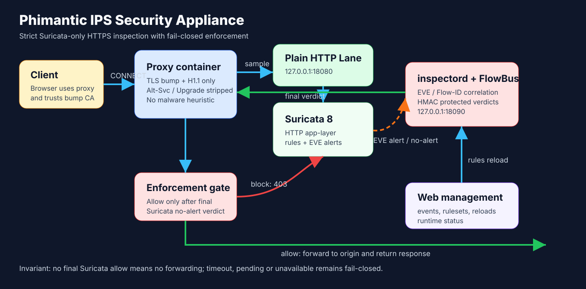
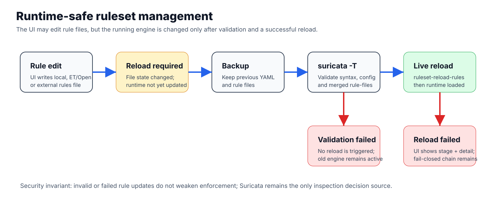
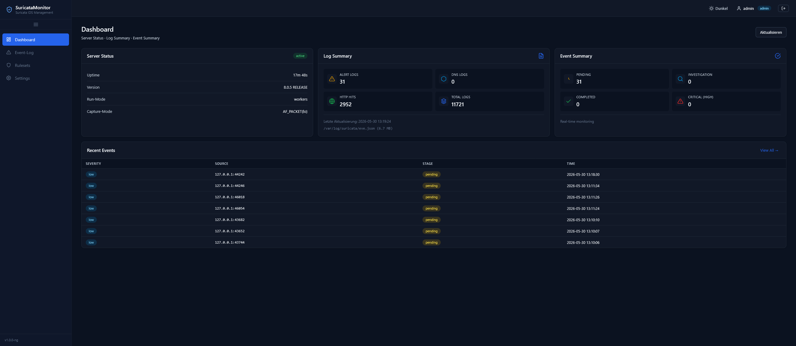
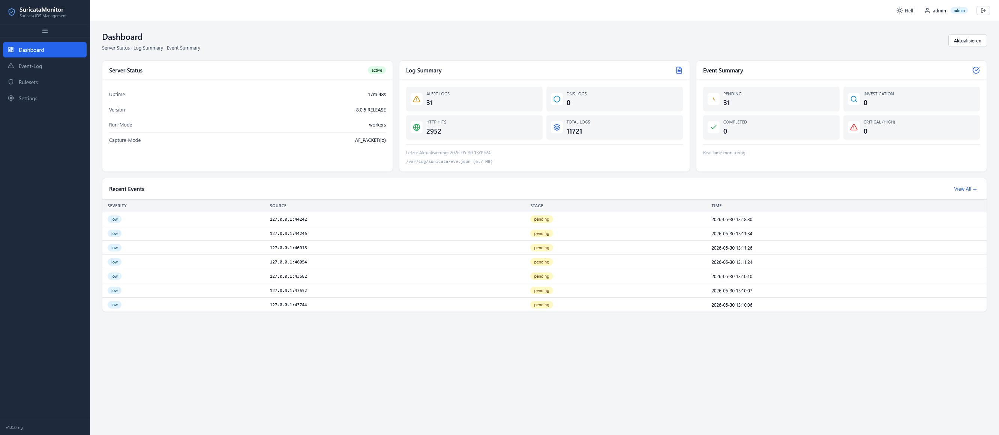
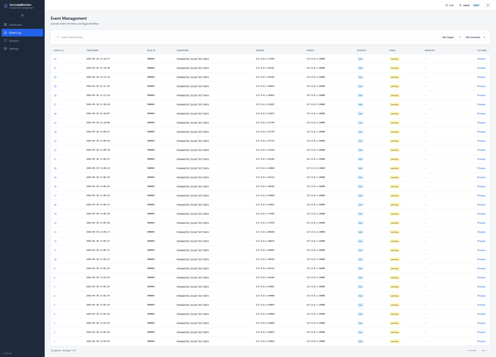
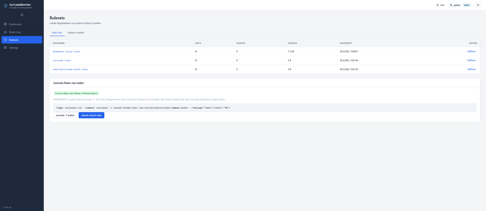
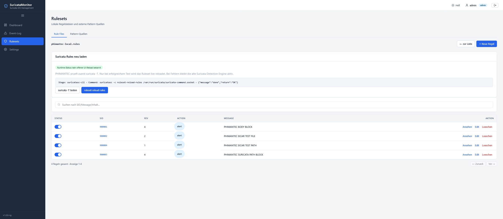
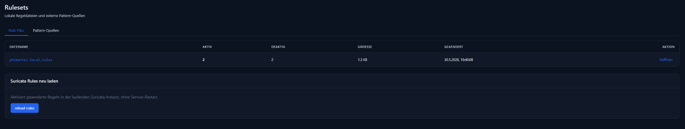
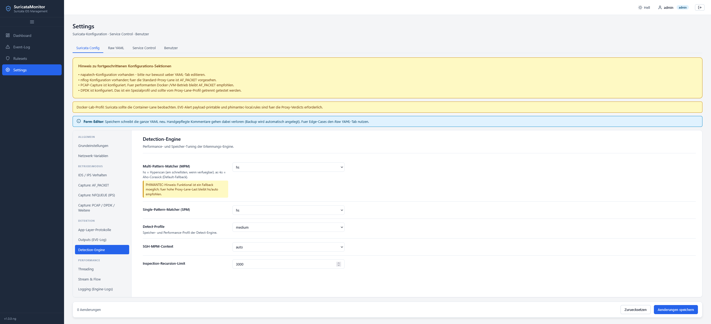

# Phimantic-IPS-Security-Appliance

A strict, fail-closed HTTPS inspection appliance that decrypts browser traffic locally, sends the resulting HTTP/1.1 traffic to Suricata, correlates Suricata EVE output with proxy flow IDs, and forwards content only after a final Suricata-derived allow verdict.

The implementation is intentionally conservative: Suricata remains the only security decision source. The proxy does not contain a malware heuristic, an EICAR shortcut, a CDN bypass, a media bypass, or a fail-open fallback. If a final Suricata allow verdict is not available, the proxy does not forward the content.

This repository is prepared as the public GitHub repository line for the stable appliance codebase. Existing source code is preserved; the repository packaging adds English documentation, GitHub policy files, UI screenshots and architecture diagrams.

## What the system does

Phimantic-IPS-Security-Appliance provides a local security gateway for HTTPS browser traffic:

- terminates client TLS through a locally generated and trusted bump CA;
- forces HTTP/1.1-only operation and strips HTTP/2 upgrade hints such as Alt-Svc and Upgrade headers;
- sends decrypted HTTP request and response samples to a local Suricata lane;
- lets Suricata inspect the traffic with local, ET/Open and external rulesets;
- reads Suricata EVE output through inspectord and correlates it with PHIMANTEC flow IDs;
- returns HMAC-protected verdicts over FlowBus;
- forwards only after a final no-alert verdict, blocks on Suricata alert, and fails closed on timeout or unavailable inspection.

## Security model

```text
Browser / Client
  -> Proxy TLS bump and HTTP/1.1 normalization
  -> Plain HTTP Lane on 127.0.0.1:18080
  -> Suricata rules, HTTP app-layer and EVE output
  -> inspectord EVE / Flow-ID correlation
  -> FlowBus verdict on 127.0.0.1:18090
  -> Proxy enforcement
```

Hard invariants:

```text
No final Suricata allow verdict -> no forwarding.
Final Suricata alert verdict    -> deterministic block page.
Pending / timeout / unavailable -> fail-closed.
```

## Architecture diagrams





More diagrams and Mermaid sources are available in [docs/diagrams](docs/diagrams/README.md).

## Screenshots

### Dashboard

| Dark theme | Light theme |
|---|---|
|  |  |

### Events and rulesets

| Event management | Rulesets overview |
|---|---|
|  |  |

| Rule files | Rulesets wide view |
|---|---|
|  |  |

### Settings



## Main features

- Suricata-only inspection decision chain.
- Strict fail-closed enforcement.
- Local HTTPS TLS bump with generated CA.
- HTTP/1.1-only mode for deterministic inspection.
- Alt-Svc, Alt-Used, Upgrade and HTTP2-Settings header stripping.
- FlowBus HMAC-protected verdict protocol.
- Multi-stream inspection gate with bounded queueing and inflight limits.
- Stable FlowBus default: fresh connection per verdict, keepalive disabled by default.
- Web management for dashboard, events, local rules, ET/Open rulesets, external rules and runtime reload.
- Safe ruleset reload workflow: backup, `suricata -T`, `ruleset-reload-rules`, fallback handling and runtime state reporting.
- EICAR matrix test and deployment smoke tests.

## Repository structure

```text
appliance/                  C11 proxy, TLS bump, lane client, verdict enforcement
shared/                     common C modules, config, FlowBus, H1 helpers
suricata-node/              lane sink and inspectord
suricata-monitor/           web management UI and backend
config/                     default appliance and monitor configuration
docker/                     Docker build definitions
docs/                       diagnostics, diagrams, screenshots and release notes
scripts/                    deployment, smoke tests, rule repair and verification
tests/                      C and Python regression tests
third_party/                source placeholders and patch metadata
```

## Requirements

Recommended host profile:

- Ubuntu 24.04 LTS or a comparable modern Linux host;
- Docker Engine with the Docker Compose plugin;
- `bash`, `curl`, `openssl`, `sha256sum`, `unzip`;
- internet access during the first Docker build, unless the offline dependency directories are populated;
- free TCP ports `3128` for the proxy and `5050` for the web management UI;
- permission to manage Docker containers and local firewall rules.

## Quick deployment

### 1. Get the repository

For a GitHub clone:

```bash
git clone https://github.com/<owner>/Phimantic-IPS-Security-Appliance.git
cd Phimantic-IPS-Security-Appliance
```

For a release ZIP that contains the original release directory:

```bash
cd "$HOME"
unzip -q -o Phimantic-IPS-Security-Appliance.zip
cd phimantec-c11-appliance-v0.3.18-monitor-offline-vendor
```

The deployment guard intentionally validates the historical release directory name. When deploying from a GitHub clone with a different directory name, set:

```bash
export PHIMANTEC_ALLOW_RENAMED_ROOT=1
```

### 2. Prepare configuration

```bash
sha256sum -c MANIFEST.sha256
rm -f .env
cp .env.example .env
```

Review `.env` before production use. At minimum, change default credentials and tokens before exposing the management UI beyond a trusted lab network.

### 3. Deploy

```bash
PHIMANTEC_ALLOW_RENAMED_ROOT=1 PHIMANTEC_AUTO_STOP_LEGACY_HOST_SERVICES=1 scripts/phimantec_deploy.sh --no-cache
```

### 4. Run smoke tests

```bash
scripts/phimantec_smoke.sh
PROXY_URL=http://127.0.0.1:3128 scripts/eicar_url_matrix_test.sh
```

Expected result:

```text
Smoke test: PASS
EICAR matrix: all samples blocked, no EICAR cleartext leak
```

### 5. Import the proxy CA

The deployment exports the bump CA to:

```text
~/phimantec-bump-ca.crt
```

Import this certificate into the test browser as a trusted certificate authority for websites. In Firefox, remove older PHIMANTEC test CAs first, then import the current CA under certificate authorities and enable website trust.

### 6. Configure the browser proxy

Set the browser or operating system proxy to:

```text
HTTP proxy: 127.0.0.1
Port:       3128
```

Disable HTTP/3 in the test browser while validating this HTTP/1.1-only inspection mode.

### 7. Open the web management UI

```text
http://127.0.0.1:5050/
```

Default lab login:

```text
admin / changeme
```

Change the password immediately after first login.

## Ruleset management

The web UI supports local rules and external Suricata-compatible rulesets. Runtime reload is designed to avoid drift between edited files and the running Suricata detection engine.

Safe reload workflow:

```text
1. Edit or import rules in the UI.
2. Save the file.
3. UI marks the runtime state as reload required.
4. Reload Rules executes backup + suricata -T.
5. Only a valid configuration is sent to ruleset-reload-rules.
6. The UI reports success or the exact failed stage.
```

Manual runtime reload check:

```bash
scripts/phimantec_compose.sh compose exec -T suricata-node sh -lc '
set -e
suricata -T -c /etc/suricata/suricata.yaml -v
suricatasc -c ruleset-reload-rules /var/run/suricata/suricata-command.socket   || suricatasc -c ruleset-reload-rules   || kill -USR2 "$(pidof suricata)"
'
```

ET/Open and external rule files are loaded through `suricata.yaml` rather than through a single-file `-S` override. Local PHIMANTEC rules remain preserved and are loaded together with generated and external rules.

## Verification commands

```bash
sha256sum -c MANIFEST.sha256
bash -n scripts/*.sh
python3 tests/test_suricata_yaml_patch.py
python3 tests/test_proxy_streaming_guard.py
python3 suricata-monitor/tests/test_config_manager_paths.py
python3 suricata-monitor/tests/test_eve_reader_cursor.py
python3 suricata-monitor/tests/test_rules_reload_management.py
scripts/verify_docker_static.sh
scripts/verify_release.sh
```

`verify_release.sh` performs static checks, Python checks, JavaScript syntax checks when Node.js is available, CA generation smoke tests, a CMake build and CTest. Docker runtime tests must be run on a host with a working Docker daemon.

## Troubleshooting quick reference

### Deployment guard reports a wrong directory

The source tree was probably cloned into a GitHub repository directory instead of the historical release directory. Use:

```bash
export PHIMANTEC_ALLOW_RENAMED_ROOT=1
```

### Port 3128 or 5050 is already in use

```bash
ss -ltnp | grep -E ':(3128|5050)\b' || true
docker ps -a --filter "name=phimantec"
```

Stop stale containers:

```bash
docker ps -a --filter "name=phimantec" -q | xargs -r docker rm -f
```

### Browser shows certificate errors

Re-export and import the current CA:

```bash
scripts/export_docker_ca.sh
ls -l ~/phimantec-bump-ca.crt
```

Then remove stale PHIMANTEC CAs from the browser and import the current one.

### A harmless page returns Inspection Unavailable

Inspection unavailable is fail-closed behavior. Check the exact reason and the FlowBus probe:

```bash
scripts/phimantec_compose.sh compose logs --no-color --tail=800 proxy suricata-node   | grep -E 'Inspection unavailable|inspection-|FlowBus|verdict|lane|timeout|queue' || true

scripts/phimantec_compose.sh compose exec -T suricata-node   /usr/local/bin/phimantec-flowbus-probe -c /etc/phimantec/phimantec-suricata-node.conf -t 1000
```

### Rules reload fails

The reload path should report the failed stage. Validate manually:

```bash
scripts/phimantec_compose.sh compose exec -T suricata-node sh -lc '
suricata -T -c /etc/suricata/suricata.yaml -v
suricatasc -c ruleset-stats /var/run/suricata/suricata-command.socket || true
suricatasc -c ruleset-failed-rules /var/run/suricata/suricata-command.socket || true
'
```

### EICAR is not blocked

Do not continue using the system as an enforcement gateway until this is fixed:

```bash
PROXY_URL=http://127.0.0.1:3128 scripts/eicar_url_matrix_test.sh
scripts/phimantec_compose.sh compose logs --no-color --tail=800 suricata-node proxy
```

Confirm that Suricata is running, local rules are loaded, EVE output is written, inspectord is running and FlowBus HMAC tokens match.

More details are available in [TROUBLESHOOTING.md](TROUBLESHOOTING.md) and [DEPLOYMENT.md](DEPLOYMENT.md).

## Documentation index

- [DESCRIPTION.md](DESCRIPTION.md) — product description and operating model.
- [DEPLOYMENT.md](DEPLOYMENT.md) — detailed step-by-step rollout.
- [TROUBLESHOOTING.md](TROUBLESHOOTING.md) — operational fault handling.
- [SECURITY.md](SECURITY.md) — security policy and disclosure process.
- [CONTRIBUTION.md](CONTRIBUTION.md) — contribution guidelines.
- [CODE_OF_CONDUCT.md](CODE_OF_CONDUCT.md) — community conduct.
- [LICENSE.md](LICENSE.md) — license terms.
- [docs/diagrams](docs/diagrams/README.md) — SVG and Mermaid diagrams.
- [docs/screenshots](docs/screenshots/README.md) — UI screenshots.

## Acknowledgements

The web management UI is based on and adapted from the `suriguard` UI template by SEc-123: <https://github.com/SEc-123>. The appliance also builds on the Suricata ecosystem and keeps Suricata as the only security inspection decision source. Historical clean-room notes for SSL/TLS proxy design are kept in `third_party_reference/sslsplit-analysis`.

## License

This repository is distributed under the GNU Affero General Public License v3.0 or later unless a file states otherwise. See [LICENSE.md](LICENSE.md).
