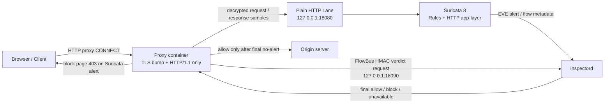
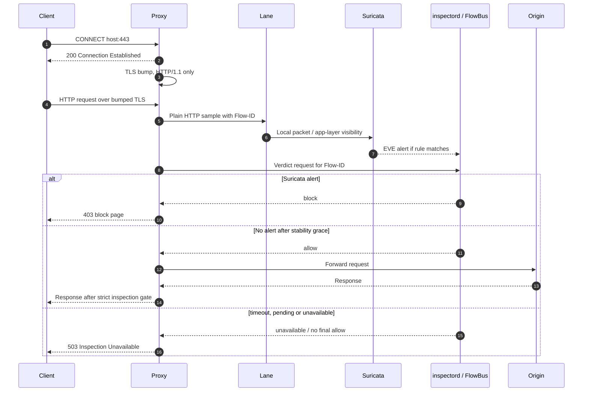
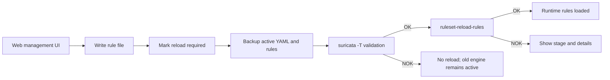

# Phimantic-IPS-Security-Appliance Architecture Diagrams

These diagrams describe the public repository architecture. They intentionally focus on the stable security chain rather than on historical version numbers.

## Security Chain

## Runtime Verdict Sequence

## Ruleset Reload

## Supplied legacy planning diagrams

The original architecture bundle supplied with the project is also preserved for reference:

- [Provided lab architecture SVG](provided-lab-architecture.svg)
- [Provided inline bridge vision SVG](provided-inline-bridge-vision.svg)
- [Provided Mermaid architecture notes](provided-mermaid-architecture.md)
