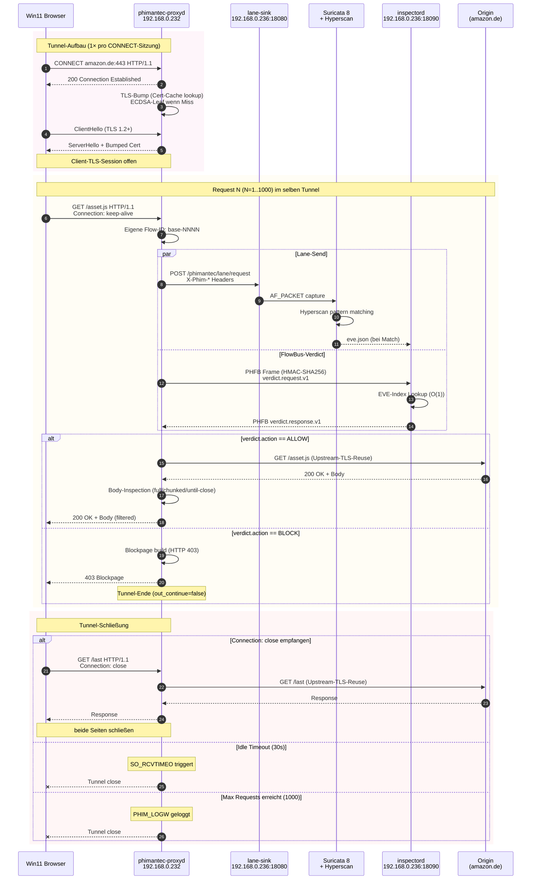
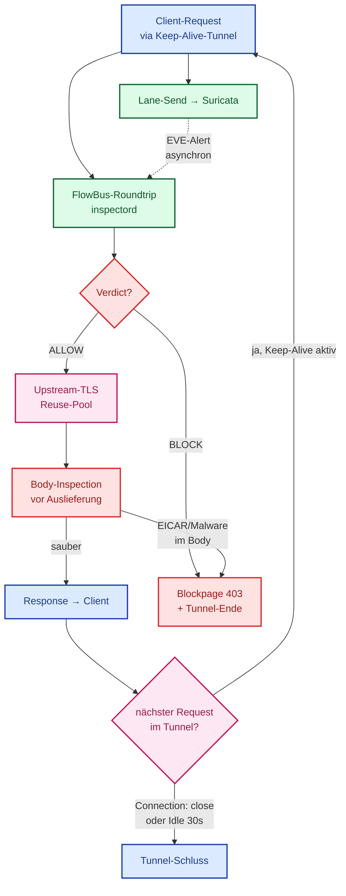
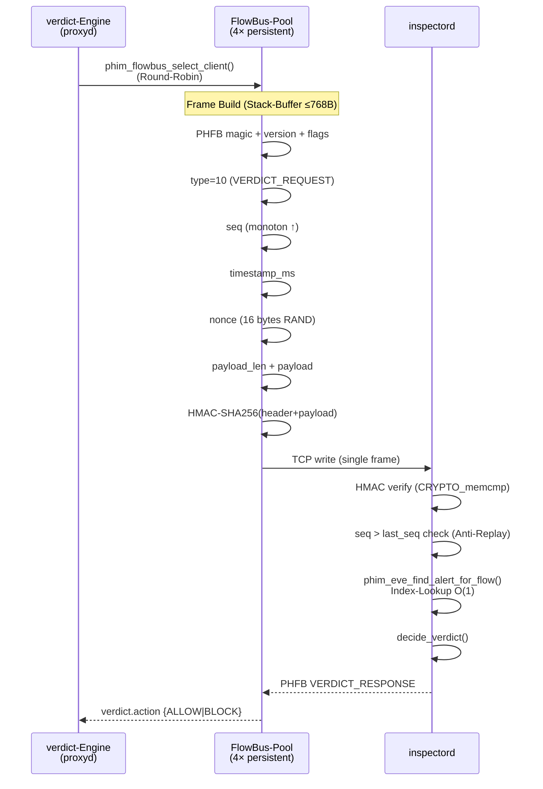

# PHIMANTEC C11 Appliance v0.2.0 — Architektur in Mermaid

## Variante 1: Komplett-Architektur (flowchart LR)

```mermaid
flowchart LR
    classDef client    fill:#fde68a,stroke:#b45309,stroke-width:2px,color:#7c2d12
    classDef proxy     fill:#dbeafe,stroke:#1e40af,stroke-width:2px,color:#1e3a8a
    classDef inspect   fill:#fffbeb,stroke:#d97706,stroke-width:2px,color:#92400e
    classDef verdict   fill:#fee2e2,stroke:#dc2626,stroke-width:2px,color:#991b1b
    classDef suri      fill:#dcfce7,stroke:#166534,stroke-width:2px,color:#14532d
    classDef neuv020   fill:#fce7f3,stroke:#be185d,stroke-width:2px,color:#9d174d
    classDef pipe      fill:#fff,stroke:#475569,stroke-width:1px,color:#0f172a

    subgraph CLIENT["Win11 Client · 192.168.0.233"]
        BR[Browser<br/>PHIMANTEC Root-CA installiert<br/>about:config http3=false]:::client
    end

    subgraph PROXY_HOST["Proxy-Host · 192.168.0.232 · phimantec-proxyd v0.2.0"]
        direction TB

        subgraph WORKER["★ Worker-Loop (NEU v0.2.0) · 1 CONNECT = N Requests"]
            direction LR
            W1[① CONNECT-Parser]:::proxy
            W2[② TLS-Bump · ECDSA<br/>Cert-Cache 1024]:::proxy
            W3[③ H1 Parser +<br/>Chunked-Decoder]:::proxy
        end

        subgraph PIPE["Inspection-Pipeline pro Request"]
            direction LR
            P1[④ Response-Body-<br/>Inspection · 3 Pfade]:::inspect
            P2[⑤ Verdict-Engine<br/>FlowBus-Pool 4×]:::verdict
        end

        subgraph EGRESS["Egress + Sidechannel"]
            direction LR
            E1[⑥ Lane-Pool 4×<br/>HTTP Keep-Alive]:::proxy
            E2[⑦ Upstream-TLS-Reuse ★<br/>SSL_CTX-Cache 256]:::neuv020
            E3[⑧ Blockpage<br/>HTTP 403]:::verdict
        end

        SLOW[Slowloris-Schutz<br/>max 1000 Req · 30s Idle]:::neuv020
    end

    subgraph SURI_HOST["Suricata-Host · 192.168.0.236"]
        direction LR
        LS[lane-sink :18080<br/>Keep-Alive]:::suri
        SUR[Suricata 8<br/>Hyperscan MPM/SPM<br/>SID 900001-3]:::suri
        IS[inspectord :18090<br/>EVE-Index inkrementell<br/>4096 Slots · 120s TTL]:::suri
    end

    INTERNET[("WWW · Internet<br/>amazon.de / youtube.com / ...")]:::pipe

    BR -->|CONNECT host:443<br/>HTTPS · TLS-Bump| W1
    W1 --> W2 --> W3
    W3 --> P1
    P1 --> P2
    P2 --> E1
    P2 --> E2
    P2 --> E3
    E2 -->|Upstream TLS<br/>http/1.1 ALPN| INTERNET
    E1 -.->|Klartext POST<br/>TCP 18080| LS
    P2 -.->|PHFB + HMAC-SHA256<br/>TCP 18090| IS
    LS -.->|AF_PACKET| SUR
    SUR -.->|eve.json| IS
    IS -.->|VERDICT_RESPONSE<br/>allow / block| P2
    E3 -.->|HTML Blockpage<br/>via Client-TLS| BR
    WORKER -.- SLOW

    linkStyle 0  stroke:#1d4ed8,stroke-width:2px
    linkStyle 6  stroke:#7c3aed,stroke-width:2px,stroke-dasharray:6 3
    linkStyle 7  stroke:#15803d,stroke-width:2px,stroke-dasharray:6 3
    linkStyle 8  stroke:#c2410c,stroke-width:2px,stroke-dasharray:6 3
    linkStyle 9  stroke:#0e7490,stroke-width:2px,stroke-dasharray:4 3
    linkStyle 10 stroke:#0e7490,stroke-width:2px,stroke-dasharray:4 3
    linkStyle 11 stroke:#c2410c,stroke-width:2px,stroke-dasharray:6 3
    linkStyle 12 stroke:#b91c1c,stroke-width:2px,stroke-dasharray:4 3
```



---

## Variante 2: Hot-Path-Sequenz (sequenceDiagram)



---

## Variante 3: Datenfluss-Übersicht (flowchart TD, kompakt)



---

## Variante 4: FlowBus-Frame-Layout (sequenceDiagram, technisch)



---

## Nutzungshinweise

**Rendering**: Alle Diagramme rendern in jeder Mermaid-fähigen Markdown-Pipeline (GitHub, GitLab, MkDocs, Docusaurus, HedgeDoc, Obsidian, VSCode mit "Markdown Preview Mermaid Support").

**Themes**: Für Dark-Mode-Rendering Mermaid mit `theme: dark` initialisieren:

```html
<script>
  mermaid.initialize({ theme: 'dark', startOnLoad: true });
</script>
```

**Export zu SVG/PNG**:

```bash
# Mermaid CLI installieren
npm install -g @mermaid-js/mermaid-cli

# Export
mmdc -i phimantec-architecture.mmd -o phimantec-architecture.svg
mmdc -i phimantec-architecture.mmd -o phimantec-architecture.png -w 2400
```
